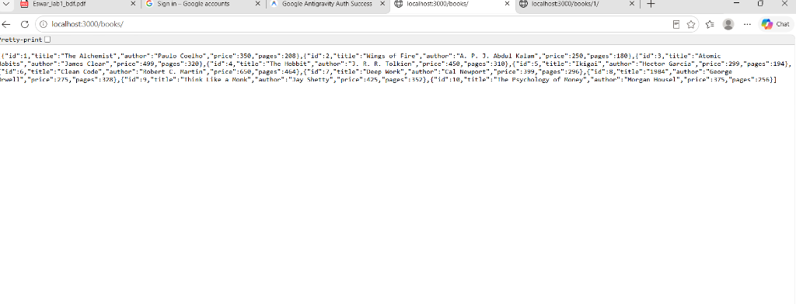
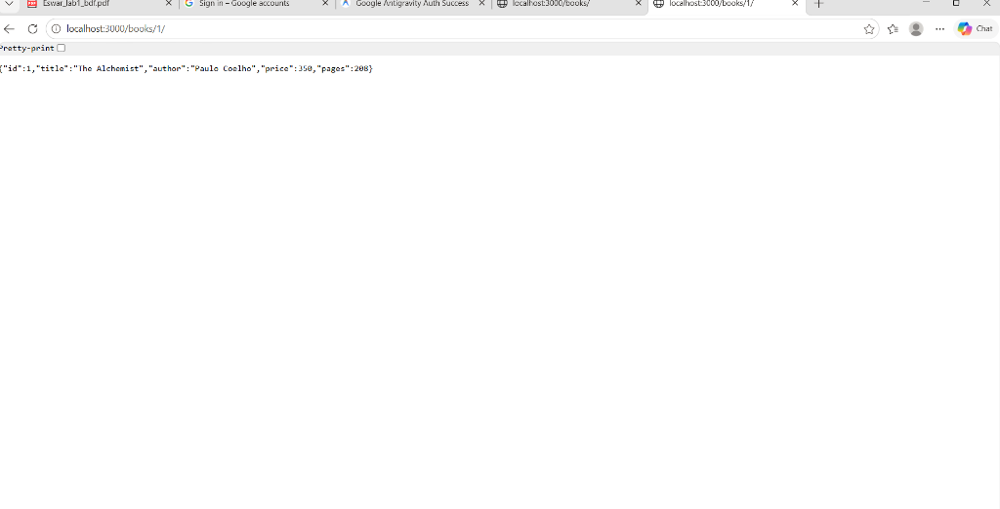
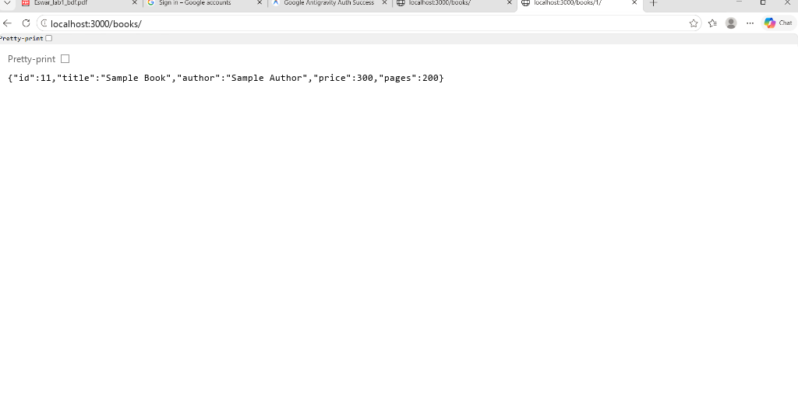
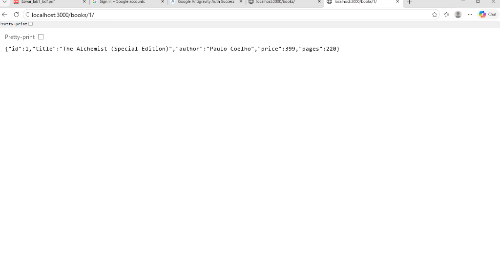
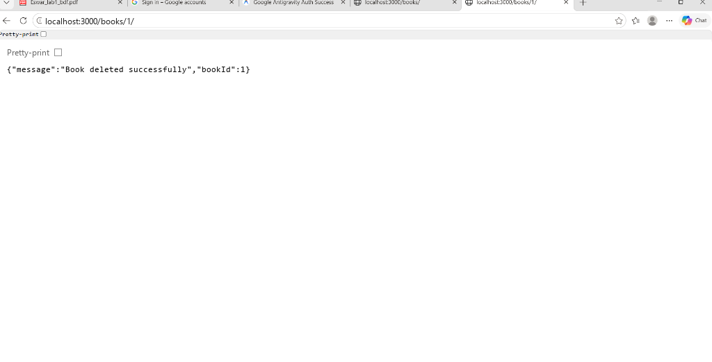
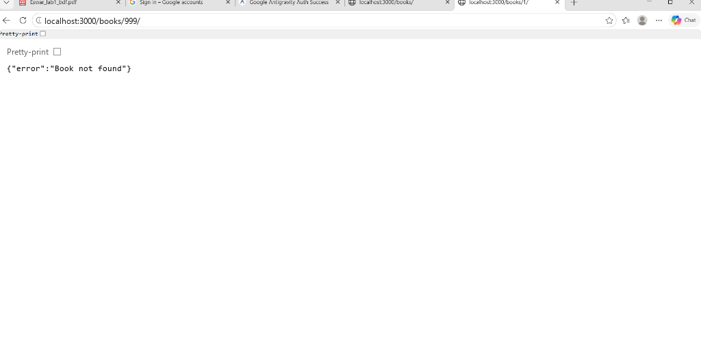

# Lab 2: SQLite database and CRUD routes

**Name:** Y. Eswar Sai Durga Prasad  
**Registration number:** 252U1R3104  
**Section:** CSE-DS-2B  
**Course:** Backend Development Fundamentals

## Live link
Not deployed yet. SQLite is stored in a local database file. For deployment, configure a persistent disk and set `DB_PATH` to a path on that disk; an ephemeral deployment filesystem may lose database changes after restart.

## Objective
Connect an Express server to SQLite and expose five CRUD operations over HTTP.

## Requirements
- Node.js 18 or later (Node.js 18+ provides the built-in `fetch` used by the API test).
- npm

## Install and run
```bash
cd lab-02
npm install
npm run dev
```
The server starts at `http://localhost:3000`. Nodemon restarts it when source files change.

Optional environment variables:
- `PORT` — HTTP port (default: `3000`).
- `DB_PATH` — SQLite database file path (default: `database/books.db`).

Do not put real secrets in the README. This project does not require credentials.

## Database
The SQLite file is `database/books.db`. It contains the `book` table and 10 sample rows. SQL setup and sample data are also provided in `database/schema.sql` and `database/seed.sql`.

Inspect the database using SQLite CLI:
```bash
sqlite3 database/books.db
.tables
.schema book
SELECT * FROM book;
.quit
```

## Endpoints

| Method | Path | Description | Success status |
|---|---|---|---|
| GET | `/books/` | Retrieve all books | 200 |
| GET | `/books/:bookId/` | Retrieve one book by ID | 200 |
| POST | `/books/` | Add a book | 201 |
| PUT | `/books/:bookId/` | Replace a book's details | 200 |
| DELETE | `/books/:bookId/` | Delete a book | 200 |

### POST and PUT JSON body
```json
{
  "title": "Sample Book",
  "author": "Sample Author",
  "price": 300,
  "pages": 200
}
```
`title` and `author` must be non-empty strings, `price` a non-negative integer, and `pages` a positive integer. All SQL statements that use user input are parameterised with `?` placeholders.

## Test the API
Keep the server running in one terminal. In another terminal:
```bash
npm run test:api
```
The test checks all five routes and a not-found case. You can also import these requests into Postman manually:
- `GET http://localhost:3000/books/`
- `GET http://localhost:3000/books/1/`
- `POST http://localhost:3000/books/` with the JSON body above
- `PUT http://localhost:3000/books/1/` with the JSON body above
- `DELETE http://localhost:3000/books/1/`

Compare changes with `SELECT * FROM book;` in SQLite CLI.

## Screenshots

### 1. GET All Books (`/books/`)
- **Method:** `GET`
- **URL:** `http://localhost:3000/books/`
- **Description:** Retrieves all books from the SQLite database.



### 2. GET Book by ID (`/books/1/`)
- **Method:** `GET`
- **URL:** `http://localhost:3000/books/1/`
- **Description:** Retrieves a single book by ID.



### 3. POST - Add a Book (`/books/`)
- **Method:** `POST`
- **URL:** `http://localhost:3000/books/`
- **Description:** Adds a new book to the database (Status: `201 Created`).



### 4. PUT - Update a Book (`/books/1/`)
- **Method:** `PUT`
- **URL:** `http://localhost:3000/books/1/`
- **Description:** Replaces / updates details of an existing book by ID (Status: `200 OK`).



### 5. DELETE - Delete a Book (`/books/1/`)
- **Method:** `DELETE`
- **URL:** `http://localhost:3000/books/1/`
- **Description:** Deletes a book from the database by ID (Status: `200 OK`).



### 6. Error Case - Not Found (`/books/999/`)
- **Method:** `GET`
- **URL:** `http://localhost:3000/books/999/`
- **Description:** Handles requests for non-existent IDs (Status: `404 Not Found`).



See `screenshots/README.md` for the required screenshot checklist.

## Viva preparation
1. **Why await the database call?** Database operations are asynchronous. `await` pauses the async function until the operation finishes, so the route can send the correct result and handle errors.
2. **What is SQL injection and how do placeholders prevent it?** SQL injection is an attack where untrusted input changes the meaning of an SQL query. Placeholders keep user values separate from SQL code, so the database treats them as data.
3. **When is PUT used instead of POST?** POST commonly creates a new resource. PUT updates/replaces the resource identified by the URL, such as `/books/3/`.

## Notes: problems faced and how they were solved
- The server must not listen before the database connection succeeds; `initializeDBAndServer()` awaits the connection before calling `app.listen()`.
- User-provided values are passed as parameters rather than concatenated into SQL.
- Input validation and 400, 404, and 500 responses are included to make route behaviour predictable.

## GitHub submission
Create or use your course repository and place this folder at `lab-02/`. Add your details above, capture the required screenshots, then commit and push:
```bash
git add lab-02
git commit -m "Complete Lab 2 SQLite CRUD routes"
git push
```
Do not commit `node_modules/` or `.env`.
